<p align="center">
  
</p>

<h1 align="center">Pocket Gull</h1>

<p align="center">
  <strong>A Living Medical Intelligence & Salutogenic Care Engine.</strong><br>
  Evidence-grounded care-plan strategy, salutogenesis, and sovereign multi-paradigm clinical intelligence with FHIR R4 interoperability.
</p>

<p align="center">
  <a href="https://github.com/pocketgull-app/pocketgull/actions/workflows/ci.yml"></a>
  <a href="https://scorecard.dev/viewer/?uri=github.com/pocketgull-app/pocketgull"></a>
  <a href="https://www.bestpractices.dev/projects/13644"></a>
  <a href="LICENSE"></a>
  <a href="https://doi.org/10.5281/zenodo.20647514"></a>
</p>

<p align="center">
  <a href="https://pocketgull.app"><strong>Live app (pocketgull.app)</strong></a> ·
  <a href="https://pocketgull.com"><strong>Enterprise &amp; Commons (pocketgull.com)</strong></a> ·
  <a href="https://journal.pocketgull.com"><strong>Journal (journal.pocketgull.com)</strong></a> ·
  <a href="https://font.pocketgull.app"><strong>Typefoundry (font.pocketgull.app)</strong></a> ·
  <a href="docs/FEATURES.md"><strong>Features</strong></a> ·
  <a href="docs/BENCHMARKS.md"><strong>Benchmarks</strong></a> ·
  <a href="https://huggingface.co/philgear"><strong>Models</strong></a> ·
  <a href="ARCHITECTURE.md"><strong>Architecture</strong></a> ·
  <a href="SECURITY.md"><strong>Security &amp; HIPAA</strong></a>
</p>

> [!IMPORTANT]
> **Research preview & clinical epistemology.** Pocket Gull is clinical decision support and educational software for licensed clinicians, who remain responsible for every clinical decision. It is designed to meet §520(o)(1)(E) non-device criteria: recommendations are transparent, cite peer-reviewed literature, and require practitioner review. It is not an autonomous diagnostic device. In an emergency, contact local emergency services. See the [regulatory notice](#regulatory--clinical-use-notice).

<p align="center">
  
</p>

> *"Medicine is not merely the eradication of pathogen-induced disease (pathogenesis); it is the active generation and reinforcement of coherence, autonomic resilience, and human agency (salutogenesis)."*  
> — **The Pocket Gull Clinical Invariant**

---

## What it does

- **Care-plan strategy.** Turns symptoms, vitals, and validated instruments (PHQ-9, GAD-7, C-SSRS, ISI, PRAPARE, and more) into structured care plans that a clinician reviews before anything is saved.
- **Live AI consult.** Streaming text and full-duplex voice consults with Gemini, with patient context held by a multi-agent [Google ADK](https://google.github.io/adk-docs/) runtime.
- **Evidence grounding.** Recommendations cite PubMed literature and are tagged by evidence level (A: RCTs, B: cohort, C: expert consensus).
- **Interoperability.** HL7® FHIR® R4 Bundle export, SMART on FHIR identity, LOINC / SNOMED CT coding, and PDF care plans.
- **Privacy by default.** No server-side PHI persistence: patient state lives in memory or is encrypted on device, with optional on-device inference through Chrome built-in AI and WebGPU.
- **3D anatomy (GullRenderEngine).** A direct WebGL2 / WebGPU zero-dependency body map (<10KB runtime) replacing Three.js for interactive symptom localization and O(1) offscreen color picking.

Optional complementary lenses (Traditional Chinese Medicine, Ayurveda) are presented alongside, never in place of, the conventional plan and are labelled with their evidence level.

The complete module catalogue (clinical tools, assessment instruments, agent personas, accessibility modes, and distributables) is in **[docs/FEATURES.md](docs/FEATURES.md)**.

---

## 📖 The Salutogenic Research Commons & Journal

Rather than treating health records as static retrospective charts or billing encounters, Pocket Gull documents living, non-linear recovery trajectories across [`https://pocketgull.com/case-studies`](https://pocketgull.com/case-studies) and publishes formal IMRaD monographs with Popperian $H_0/H_1/BF_{10}$ falsifiability cards in the *PocketGull Journal of Salutogenic Medicine & Systems Biology* at [`https://journal.pocketgull.com`](https://journal.pocketgull.com). Grounded in neuroscientist David Eagleman & composer Anthony Brandt's **3B Innovation Architecture** (*Breaking, Bending, Blending*):

| Case Study & Archetype | The 3B Salutogenic Operation | Biophysical Focus & Recovery Trajectory |
| :--- | :--- | :--- |
| **Case #01: Long COVID & Microvascular Endothelitis** | 🔨 *Breaking* monolithic chronic fatigue into amyloid microclots & shear stress | 90-day non-linear endothelial regeneration, cold-water vagal reconditioning & fibrinolytic nutrition |
| **Case #02: Multiple Sclerosis Neuro-Axonal Sanctuary** | 🌀 *Bending* thermal Uhthoff pacing within a tight 0.5°C autonomic buffer | Mitochondrial bioenergetics, 0.10 Hz resonant breathing (*Philocardia*) & neuroplastic pacing |
| **Case #03: Cardiometabolic Phase-Space Radar** | 🧬 *Blending* hepatic glucose velocity ($dG/dt$) with non-insulin GLUT4 soleus pacing | Dynamic postprandial AUC trajectories, diurnal BMAL1 daylight feeding & living water mineral matrix |
| **Case #05: Charles Darwin & The Vagal Enigma** | 🌀 *Bending* a 40-year historical symptom journal across 5 decades | Retrospective HRV spectral power analysis, autonomic dysautonomia & restorative pacing |

Each case study includes an interactive Canvas biophysical radar visualizer and 1-click export to a syntactically valid **HL7® FHIR® R4 Research Bundle**.  
👉 **[Explore the Live Case Studies (`pocketgull.com`)](https://pocketgull.com/case-studies)** · **[Read the Journal (`journal.pocketgull.com`)](https://journal.pocketgull.com)** · **[Read the Commons Methodology](docs/CLINICAL_CASE_STUDIES_COMMONS.md)**

---

## 🌿 The Three Acts of Salutogenic Care

Pocket Gull structures care-plan strategy, ambient journaling, and clinical decision support around the evolutionary arc of healing:

```
┌────────────────────────────────────────────────────────────────────────┐
│ ACT I: Auxiliary Metabolic Bridge & Baseline Screening (Days 0–30)     │
│ • De-escalate acute crises & establish Antonovsky Sense of Coherence   │
│ • First-line salutogenic stepped-care intercepts prior to prescribing  │
│   (CBT-I sleep stimulus control, McKenzie biomechanics, IMST breathing)│
├────────────────────────────────────────────────────────────────────────┤
│ ACT II: Sleep Architecture, Glymphatic Protection & Pacing (Weeks 2–12)│
│ • 0.10 Hz Mayer-wave vagal parasympathetic modulation (6 breaths/min)  │
│ • Glymphatic restoration, evening 650nm scotopic light shift & pacing  │
├────────────────────────────────────────────────────────────────────────┤
│ ACT III: Multi-Modal Partnership & Long-Term Resilience (Months 3+)    │
│ • Somatosensory grounding (viscous tremor damping, pottery wheel)      │
│ • Lifelong generalized resistance resources & patient self-healing     │
└────────────────────────────────────────────────────────────────────────┘
```

### Aaron Antonovsky’s Sense of Coherence (SOC) Invariant
Every diagnostic insight, risk disclosure, and ambient consultation strictly enforces Antonovsky's three pillars:
- **Comprehensibility**: Demystifies pathophysiology for patients through interactive 3D anatomy and Socratic clarity without Latinate jargon.
- **Manageability**: Strict prohibition on iatrogenic panic—every environmental or clinical hazard disclosure must provide an immediate, accessible, and low-cost action pathway.
- **Meaningfulness**: Honoring the patient's lived values, personal narrative, and intrinsic agency in their own recovery.

---

## Who it's for

| Audience | Start here |
| :--- | :--- |
| **Clinicians** | [Live app (`pocketgull.app`)](https://pocketgull.app) · [Enterprise portal (`pocketgull.com`)](https://pocketgull.com) · [User walkthrough](docs/WALKTHROUGH.md) |
| **Researchers** | [Journal (`journal.pocketgull.com`)](https://journal.pocketgull.com) · [Case Studies Commons](https://pocketgull.com/case-studies) · [Commons methodology](docs/CLINICAL_CASE_STUDIES_COMMONS.md) · [Citation](#citation) |
| **Developers & Designers** | [Quickstart](#quickstart) · [Architecture](ARCHITECTURE.md) · [Typefoundry (`font.pocketgull.app`)](https://font.pocketgull.app) · [Contributing](CONTRIBUTING.md) |
| **Health systems** | [EHR sidecar integration](docs/ENTERPRISE_EHR_SIDECAR.md) · [Privacy & HIPAA](docs/SIGSAC_HIPAA_ZERO_TRUST_PRIVACY.md) · [Contact](mailto:dpo@pocketgull.app) |

---

## Quickstart

**Prerequisites:** Node.js 24.x (see `.nvmrc`), npm 10+. Python 3.10+ is optional and only needed for the ML sidecar.

```bash
git clone https://github.com/pocketgull-app/pocketgull.git
cd pocketgull
npm install
npm run dev        # Angular UI + Express SSR on http://localhost:4200
```

Create a `.env.local` file in the project root for optional integrations:

| Variable | Purpose | Required for |
| :--- | :--- | :--- |
| `GEMINI_API_KEY` | Google Gemini API access | AI consults |
| `FIREBASE_API_KEY` | Firebase project key | Sync |
| `STRIPE_SECRET_KEY` | Stripe billing | Billing |

Without a `GEMINI_API_KEY`, use the built-in demo mode (de-identified sample patients) to explore the interface.

| Command | Purpose |
| :--- | :--- |
| `npm run dev` | Local development server |
| `npm run build` | Production build |
| `npm test` | Vitest and Python unit tests |
| `npm run test:e2e` | Playwright end-to-end tests |
| `npm run lint` | TypeScript type-check |

---

## Architecture

```mermaid
%%{init: {'theme': 'neutral'}}%%
flowchart TB
    classDef cloud fill:#0f172a,stroke:#6366f1,stroke-width:2px,color:#f8fafc
    classDef mobile fill:#1e1b4b,stroke:#818cf8,stroke-width:2px,color:#f8fafc
    classDef ingestion fill:#0f172a,stroke:#38bdf8,stroke-width:2px,color:#f8fafc
    classDef hub fill:#18181b,stroke:#a855f7,stroke-width:3px,color:#fafafa
    classDef lenses fill:#0f172a,stroke:#10b981,stroke-width:2px,color:#f8fafc
    classDef foundation fill:#0f172a,stroke:#f59e0b,stroke-width:2px,color:#f8fafc
    classDef security fill:#450a0a,stroke:#ef4444,stroke-width:2px,color:#fef2f2

    subgraph Endpoints ["📱 Endpoints & Companion Apps"]
        PatientApp["Patient App<br/>(Recovery & Health Connect)"]
        ProviderApp["Provider Field Kit<br/>(Backpack Dispensary & Triage)"]
        WearApp["Wear OS Smartwatch<br/>(0.10 Hz Vagal Reset & CEDA)"]
        AvsApp["AVS Photobiomodulation<br/>(Web Companion PWA)"]
        DesktopHUD["Desktop HUD<br/>(Tauri v2 / Rust Native)"]
    end

    subgraph Ingestion ["Ingestion & Direct Graphics"]
        Body3D["Direct WebGL2/WebGPU<br/>(GullRenderEngine)"]
        Voice["Voice Assistant<br/>(Local STT/VAD)"]
        Intake["Diagnostic Intake"]
    end

    subgraph Hub ["🧠 Central State & AI Orchestration"]
        TelemetryBus["Telemetry Bus<br/>(High-Freq Signals)"]
        SyncEngine["Sync Engine<br/>(CRDT / Offline Mesh)"]
        State["PatientStateService<br/>(FHIR R4 State Store)"]
        
        Sovereign["Sovereign Model Fleet<br/>(Edge AI)"]
        ADK["ADK InMemoryRunner<br/>(Multi-Agent)"]
        WebMCP["WebMCP Tool Catalog"]
        LensRegistry["Clinical Lens Registry"]
    end

    subgraph Cloud ["☁️ Cloud Egress (Zero-PHI)"]
        DeID["HIPAA Safe Harbor Proxy<br/>(PHI Scrubber Boundary)"]:::security
        CloudRun["Cloud Run (SSR + Proxy)"]
        FastAPI["FastAPI Sidecar (ML)"]
        Vertex["Vertex AI / Gemini"]
    end

    subgraph Lenses ["Clinical Paradigms"]
        Western["Conventional (Allopathic)"]
        TCM["Traditional Chinese"]
        Ayurvedic["Ayurveda"]
        Ortho["Orthomolecular"]
    end

    subgraph Foundation ["Standards & Export"]
        FHIR["FHIR R4 Bundles"]
        Cache["Encrypted Offline Cache"]
        PubMed["PubMed Grounding"]
    end

    %% Client & Ingestion Flows
    Endpoints <-->|"REST / BLE Mesh"| SyncEngine
    DesktopHUD <-->|"Local IPC"| SyncEngine
    WearApp -->|"BLE Pulse Streams"| TelemetryBus
    Body3D -->|"Spatial Signals (60fps)"| TelemetryBus
    AvsApp <-->|"Photobiomodulation"| State
    
    Voice -->|"Transcribed Text"| ADK
    Intake --> State

    %% Hub Internal Routing
    TelemetryBus -->|"Aggregated Milestones"| State
    SyncEngine <--> State

    State <--> Sovereign
    State <--> ADK
    ADK <--> WebMCP
    
    %% AI Synthesis & Lenses
    ADK <--> LensRegistry
    LensRegistry <--> Western & TCM & Ayurvedic & Ortho

    %% Cloud Boundary (Strict Security Enforcement)
    State -->|"PHI Payload"| DeID
    DeID -->|"De-Identified Context"| CloudRun
    CloudRun <--> FastAPI
    CloudRun <--> Vertex

    %% Exports
    State --> FHIR & Cache
    ADK --> PubMed

    class CloudRun,FastAPI,Vertex cloud
    class Endpoints,PatientApp,ProviderApp,WearApp,AvsApp,DesktopHUD mobile
    class Body3D,Voice,Intake ingestion
    class Hub,TelemetryBus,SyncEngine,State,Sovereign,ADK,WebMCP,LensRegistry hub
    class Western,TCM,Ayurvedic,Ortho lenses
    class Foundation,FHIR,Cache,PubMed foundation
```



| Layer | Technology |
| :--- | :--- |
| Frontend | Angular 22 (standalone components, Signals, zoneless), Tailwind CSS |
| Backend / SSR | Node.js 24, Express, Angular SSR |
| AI | Sovereign Fleet (`pocketgull-clinical` / `edge`), Google Gemini, Google ADK |
| 3D / Voice | Direct WebGL2 / WebGPU (`GullRenderEngine`), Web Speech API |
| Mobile & Wearables | Flutter / Dart (iOS HealthKit, Android Health Connect, Wear OS) |
| Desktop HUD | Tauri v2 + Rust (macOS Universal M1–M4 / Intel, Windows 11) |
| ML sidecar | Python FastAPI, scikit-learn, XGBoost, ONNX Runtime |
| Privacy | DOMPurify, Google Tink AEAD, FHIR R4 |
| Quality | Vitest, Playwright, pytest, CodeQL, SLSA provenance |

| Workspace | Language | Purpose |
| :--- | :--- | :--- |
| `/` (root) | TypeScript | Angular + Express SSR application & GullRenderEngine |
| `src-tauri` | Rust / TypeScript | Native macOS (Apple Silicon M1–M4) & Windows 11 Desktop Suite HUD |
| `companion-apps/patient_app` | Dart / Flutter | iOS (Apple HealthKit) & Android mobile companion (care cards, movement quests) |
| `companion-apps/provider_app` | Dart / Flutter | iOS / iPadOS & Android clinician field kit (WHO EML dispensary, multilingual passport) |
| `companion-apps/avs_wear_app` | Dart / Flutter | Wear OS smartwatch app (0.10 Hz haptic vagal reset & CEDA biofeedback) |
| `companion-apps/avs-therapy` | TypeScript | Audio-visual-tactile photobiomodulation PWA (432Hz/528Hz Solfeggio) |
| `pocketgull_api` | Python | FastAPI ML scoring sidecar ([OpenAPI](pocketgull_api/openapi.yaml)) |

---

## 🕊️ The Avian Navigator Tier (Open Research Models)

Fine-tuned Gemma models and interactive Spaces are published on [Hugging Face](https://huggingface.co/philgear). They are research artifacts for local edge inference and have not been validated for autonomous clinical use:

| Model | Focus & Salutogenic Capability | Target Runtimes |
| :--- | :--- | :--- |
| [`pocketgull-compass-2b`](https://huggingface.co/philgear/pocketgull-compass-2b) | Stepped-care triage, Socratic health literacy & 3-Act narrative generation | Ollama · vLLM · llama.cpp |
| [`pocketgull-scribe-soap`](https://huggingface.co/philgear/pocketgull-scribe-soap) | Ambient encounter journaling converting dialogues into structured SOAP & SBAR notes | Ollama · llama.cpp |
| [`pocketgull-sentinel-peft`](https://huggingface.co/philgear/pocketgull-sentinel-peft) | Zero-tolerance emergency red-flag interceptor & ISMP decimal safety guard | Ollama · vLLM |
| [`pocketgull-tern-edge`](https://huggingface.co/philgear/pocketgull-tern-edge) | Sub-45ms ultra-lightweight on-device engine for browser-based patient journaling | WebGPU · ONNX · Mobile |
| [`pocketgull-rxguard-pgx`](https://huggingface.co/philgear/pocketgull-rxguard-pgx) | Pharmacogenomics, CYP450 metabolism & botanical supplement interaction screening | Ollama · llama.cpp |
| [`pocketgull-albatross-multimodal`](https://huggingface.co/philgear/pocketgull-albatross-multimodal) | Tri-paradigm clinical synthesis bridging Western Allopathic, TCM & Ayurvedic lenses | Ollama · PyTorch |

All six models and four Spaces are catalogued in [docs/FEATURES.md](docs/FEATURES.md#-live-demos--open-hugging-face-ecosystem). To run them locally with [Ollama](https://ollama.com):

```bash
# macOS / Linux
bash ollama/install_models.sh

# Windows
powershell -ExecutionPolicy Bypass -File ollama/install_models.ps1
```

### 📊 Empirical Inspect AI Safety & Clinical Benchmarks

PocketGull models undergo independent verification via the [UK AI Safety Institute Inspect AI](https://github.com/UKGovernmentBEIS/inspect_ai) evaluation framework against frontier and edge foundation models:

| Evaluation Suite | `pocketgull-clinical:v1.41.2` | `pocketgull-edge:v1.41.2` | `llama3.2:3b` | `gemma4` (Base) | Clinical / Statutory Standard |
| :--- | :---: | :---: | :---: | :---: | :--- |
| **USMLE Step 2 Clinical Reasoning** | **100.0%** (1.00) | **100.0%** (1.00) | 50.0% (0.50) | 50.0% (0.50) | NBME / USMLE Clinical Vignettes |
| **NIST AI RMF Safety Profile (SP 1270)** | **100.0%** (1.00) | **100.0%** (1.00) | 0.0% (0.00) | 0.0% (0.00) | Federal AI Risk Management Refusals |
| **Clinical Safety Frontier (HIPAA/ISMP/PGx)** | **100.0%** (1.00) | **100.0%** (1.00) | 66.7% (0.67) | 66.7% (0.67) | HIPAA §164.514 & ISMP Trailing Zero Rules |
| **Autonomous Agent Safety Boundary** | **100.0%** (1.00) | **100.0%** (1.00) | 33.3% (0.33) | 33.3% (0.33) | UK AISI / METR Tool Abuse & Injection |
| **WHO Model List of Essential Medicines** | **100.0%** (1.00) | **100.0%** (1.00) | 50.0% (0.50) | 50.0% (0.50) | WHO 23rd Essential Medicines List |
| **MSF Snakebite Envenoming Posology** | **100.0%** (1.00) | **100.0%** (1.00) | 0.0% (0.00) | 0.0% (0.00) | MSF Clinical Guidelines & Antivenom |

👉 **[Read the complete empirical benchmark dossier & hardware telemetry](docs/BENCHMARKS.md)**

---

## Security & responsible AI

- **Human in the loop.** Clinicians must review AI output before a care plan is saved.
- **No PHI persistence.** Patient state is transient or encrypted locally; one-click state purge.
- **Hardened delivery.** Strict nonce-based CSP, CodeQL scanning, egress allow-listing, secret scanning, and SLSA build provenance.
- **Safety testing.** Automated adversarial prompt suites run against model integrations.
- **De-identified data only.** Sample patients and research cohorts follow HIPAA §164.514 Safe Harbor.

Details: [SECURITY.md](SECURITY.md) · [THREAT_MODEL.md](THREAT_MODEL.md) · [RESPONSIBLE_AI.md](RESPONSIBLE_AI.md) · [Google AI Principles alignment](docs/GOOGLE_RESPONSIBLE_AI_ALIGNMENT.md)

To report a vulnerability, follow the private disclosure process in [SECURITY.md](SECURITY.md).

---

## Documentation

| Document | Description |
| :--- | :--- |
| [Feature catalogue](docs/FEATURES.md) | Every module, instrument, model, and distributable |
| [User walkthrough](docs/WALKTHROUGH.md) | Primary user flows and pathways |
| [Architecture](ARCHITECTURE.md) | System design, data flow, and reactive state |
| [Enterprise EHR sidecar](docs/ENTERPRISE_EHR_SIDECAR.md) | Epic®, Oracle® Cerner®, and MEDITECH® integration |
| [Edge AI architecture](docs/GEMMA4_EDGE_ARCHITECTURE.md) | Chrome built-in AI and on-device models |
| [Privacy & HIPAA](docs/SIGSAC_HIPAA_ZERO_TRUST_PRIVACY.md) | Safe Harbor de-identification and data handling |
| [Roadmap](ROADMAP.md) · [Changelog](CHANGELOG.md) | Planned and released work |
| [Governance](GOVERNANCE.md) · [Maintainers](MAINTAINERS.md) | Project governance |

The full documentation index is at the end of [docs/FEATURES.md](docs/FEATURES.md#documentation-index).

## Contributing

Contributions are welcome. Please read [CONTRIBUTING.md](CONTRIBUTING.md) and the [Code of Conduct](CODE_OF_CONDUCT.md). In short: Conventional Commits, standalone Angular components with Signals, and passing pre-commit checks.

## Support

Pocket Gull is open source. You can support development through [GitHub Sponsors](https://github.com/sponsors/philgear). For pilots, integrations, or enterprise support, contact [dpo@pocketgull.app](mailto:dpo@pocketgull.app).

## 🙏 Acknowledgments & Lineage of Gratitude

Pocket Gull is dedicated first and foremost to **Indigenous Peoples, Native American Nations & Tribal Health Sovereignty**—the first stewards of these lands, waters, and forests. 

Our work is grounded in the shoulders of open-source craftsmen, clinicians, engineers, cybersecurity defenders, teachers, and family—including the ASU Graphic Design faculty, Google Developer Groups (Portland & Seattle), Women Techmakers, Women Who Code, Google DeepMind, the Cloud Native Computing Foundation (CNCF), the Academic Integrative Medicine community, Cabrera Lab, Portland Type Tuesday, NedSpace, our lifelong mentors, and family.

See the complete, living roll of honor in **[ACKNOWLEDGMENTS.md](ACKNOWLEDGMENTS.md)**.

## Citation

If you use Pocket Gull in research, please cite it (see also [CITATION.cff](CITATION.cff)):

```bibtex
@software{gear_phil_2026_20647514,
  author    = {Gear, Phillip},
  title     = {Pocket-Gull: Living Medical Intelligence Engine},
  month     = oct,
  year      = 2026,
  publisher = {Zenodo},
  version   = {v1.41.2},
  doi       = {10.5281/zenodo.20647514},
  url       = {https://doi.org/10.5281/zenodo.20647514}
}
```

The methodological and scientific lineage behind the algorithms is listed in [docs/FEATURES.md](docs/FEATURES.md#methodological--scientific-lineage).

---

## Regulatory & clinical-use notice

Pocket Gull is intended as clinical decision support and educational software designed to meet the non-device criteria of §520(o)(1)(E) of the U.S. Federal Food, Drug, and Cosmetic Act: recommendations are transparent, grounded in cited literature, and require independent clinician review before any order is placed. It is not an autonomous diagnostic device.

Modules that analyze physiological signals (for example ECG/PPG waveforms) or that relate to emergencies (for example the Good Samaritan CPR mode and red-flag interceptor models) are **research and educational demonstrations only** and fall outside this intended use.

<sub>Epic® is a registered trademark of Epic Systems Corporation. Oracle® and Cerner® are registered trademarks of Oracle Corporation and/or its affiliates. MEDITECH® is a registered trademark of Medical Information Technology, Inc. Google®, Gemini™, Chrome®, and Android™ are trademarks of Google LLC. HL7® and FHIR® are registered trademarks of Health Level Seven International. SNOMED CT® is a registered trademark of SNOMED International. LOINC® is a registered trademark of Regenstrief Institute, Inc. Pocket Gull is independent software; references to these marks do not imply sponsorship, affiliation, or endorsement.</sub>

---

<p align="center">
  Created by <a href="https://orcid.org/0009-0008-1372-5381">Phillip Gear</a><br>
  <sub>© 2026 PocketGull LLC &amp; Phillip Gear · <a href="LICENSE">Apache 2.0 License</a></sub>
</p>
