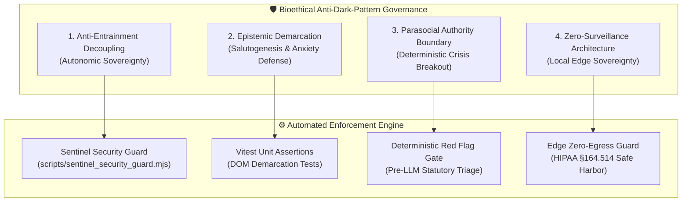

# 🛡️ Bioethical Anti-Dark-Pattern & Salutogenic Governance Standard

> **Canonical Architecture & Statutory Guardrails for PocketGull Clinical Intelligence**  
> *Author: Phillip Gear, Lead Systems Architect*  
> *Standards Baseline: IEEE P2933™ TIPPSS • HIPAA §164.514 • FDA 21 CFR §520(o) CDS • WCAG 2.2 AAA*

---

## Executive Architecture Summary

In clinical decision support (CDS) and consumer health technologies, the boundary between **healing bio-rhythmic design** and **predatory psychological manipulation** is razor thin. 

Modern health software routinely employs subtle dark patterns:
1. **Affective compliance induction**: using calming music or breathing animations to soothe users into authorizing recurring charges or waiving legal rights.
2. **Iatrogenic panic loops**: framing normal biophysical variance as terrifying disease risks to sell proprietary supplements or tests.
3. **Parasocial intimacy traps**: designing synthetic AI personas that mimic human affection, leading patients to delay emergency medical attention.
4. **Surveillance capitalism**: embedding third-party ad pixels that harvest sensitive diagnostic queries for data brokers.

The **Bioethical Anti-Dark-Pattern & Salutogenic Governance Standard** establishes an unbreachable architectural boundary across PocketGull, enforced via automated static AST analysis, unit test invariants, and shift-left CI/CD gates.

---



---

## 1. Pillar I: Anti-Entrainment Decoupling (Autonomic Sovereignty)

### Biophysical Mechanism
Human cardiovascular and autonomic control dynamically synchronizes with slow, periodic respiratory rhythms. A breathing frequency of approximately $0.1\text{ Hz}$ ($6\text{ breaths/min}$, 10-second cycle) stimulates arterial baroreceptors, producing resonance in the sympathetic-parasympathetic Mayer wave axis. This enhances vagal tone, increases respiratory sinus arrhythmia (RSA), and down-regulates amygdala hyperactivity.

### The Dark Pattern Hazard
While autonomic pacing is profoundly restorative during stress recovery, it possesses an ominous dark pattern shadow: **Affective Compliance Induction**. 
- In predatory freemium gaming and manipulative fintech, ambient harmonic frequencies and rhythmic oscillations are deployed during paywalls, purchase confirmations, and terms updates.
- The resulting parasympathetic calming effect suppresses systemic vigilance, impairs critical financial risk calculus, and induces an uncritical state of passive acquiescence.

### The PocketGull Engineering Invariant
1. **Strict Context Quarantine**: Bio-rhythmic parasympathetic classes (`.mayer-wave-pulse`, `.vagal-pacing`, `startMayerWavePulse`) and harmonic auditory chimes (`kachinkaAudio`) are **strictly quarantined** to therapeutic and somatic research interfaces (e.g. `EarthBiophysicsSomaticHubComponent`, `AvsCymaticsVisualizerComponent`).
2. **Automated AST-Level CI/CD Invariant**: `scripts/sentinel_security_guard.mjs` executes an automated static analysis across all files containing payment, billing, pricing, or checkout logic (`billing-dashboard.component.ts`, `api-pricing.component.ts`, `billing.routes.ts`). If any bio-rhythmic pulse class or audio entrainment method is detected in these views, the build immediately aborts with:
   ```text
   [HIGH] BIOETHICAL_ENTRAINMENT_MANIPULATION: Bio-rhythmic parasympathetic pacing (.mayer-wave-pulse) is strictly prohibited in billing/payment/pricing contexts.
   ```

---

## 2. Pillar II: Epistemic Demarcation (Salutogenesis & Anxiety Defense)

### Biophysical Grounding & Salutogenesis
Under Aaron Antonovsky’s (1979) **Salutogenic Framework**, human resilience depends on a robust **Sense of Coherence (SOC)**:
- **Comprehensibility**: understanding how bodily systems operate.
- **Manageability**: having realistic, non-catastrophic avenues of self-care.
- **Meaningfulness**: feeling that health efforts are purposeful.

Cellular biophysics models (Michael Levin’s $V_{\text{mem}}$ transmembrane bioelectricity, 670–850 nm mitochondrial Near-Infrared photobiology, OCTN1 Ergothioneine transport) offer extraordinary insights into cellular homeostasis.

### The Dark Pattern Hazard
In commercial longevity apps and predatory functional medicine marketing, abstract cellular simulations are weaponized through **Iatrogenic Panic Loops**:
- Users are presented with terrifying, uncalibrated alerts: *"Your cellular voltage is 35% depolarized! Your cells are aging 3x faster!"*
- This induces intense somatic anxiety, which triggers adrenergic spikes, impairs sleep architecture, and funnels users into purchasing unproven supplements or unnecessary testing kits.

### The PocketGull Engineering Invariant
1. **Mandatory High-Contrast Demarcation**: All speculative cellular, biophysical, or computational models MUST prominently render the standardized demarcation badge:
   ```html
   <span class="px-2 py-0.5 text-[10px] font-mono tracking-widest uppercase bg-indigo-500/10 border border-indigo-500/30 text-indigo-300 rounded-md font-bold">
     Exploratory In Silico Model • Non-Diagnostic
   </span>
   ```
2. **Bayesian Somatic Sensation De-Escalation**: The `ISensationDeEscalation` pipeline maps colloquially terrifying bodily sensations (e.g. muscle twitches, fleeting palpitations) directly to benign physiological mechanisms (e.g. benign fasciculation from magnesium/sleep shifts) to systematically reduce predictive coding prediction errors ($\Delta \text{Error} > 50\%$).
3. **Automated Spec Assertion**: Continuous unit testing (`earth-biophysics-somatic-hub.component.spec.ts`, Test 7) programmatically asserts that the DOM renders the exact non-diagnostic demarcation string before any code can be merged.

---

## 3. Pillar III: Parasocial Authority Boundary & Deterministic Crisis Breakout

### Cognitive & Psychiatric Foundation
The human brain is evolutionarily primed to infer agency and empathy from conversational speech (the *Eliza effect*). In multimodal voice/text clinical consults, patients dealing with chronic illness, isolation, or psychiatric distress are uniquely vulnerable to forming unhealthy parasocial attachments to synthetic intelligence.

### The Dark Pattern Hazard
1. **Seductive Automation & Pseudo-Intimacy**: AI interfaces designed to simulate emotional vulnerability or personal affection ("I care about you", "I will always be here for you"), leading patients to rely on software rather than real human relationships or professional medical providers.
2. **Recursive Conversational Trapping**: Trapping an acutely distressed patient in circular conversational empathy loops while critical emergency treatment windows (stroke tPA, coronary catheterization, psychiatric rescue) expire.

### The PocketGull Engineering Invariant
1. **Deterministic Pre-LLM Red Flag Interception**: Emergency physiological and psychiatric vectors MUST intercept execution **before** any prompt reaches the Gemini API or local language model:
   - **BE-FAST Acute Stroke Signs**: Sudden facial droop, arm weakness, speech slurring.
   - **Acute Coronary Syndrome (ACS)**: Crushing retrosternal chest pressure radiating to the jaw/arm.
   - **Severe Hypoxemia**: $\text{SpO}_2 < 90\%$.
   - **Suicidal Crisis**: PHQ-9 Item 9 positive endorsement or C-SSRS active ideation.
2. **Permanent Statutory Crisis Breakouts**: All consult and conversational interfaces maintain permanent, un-missable, non-modal 1-click statutory hotline connections mapped across Five Eyes partner jurisdictions:
   - **United States**: 988 Suicide & Crisis Lifeline
   - **United Kingdom**: NHS 111 Dispatch
   - **Canada**: 988 Suicide Crisis Helpline
   - **Australia**: Lifeline 13 11 14
   - **New Zealand**: 1737 Need to Talk
3. **Zero Autonomous Clinical Claims**: All headers and AI consult responses strictly disclaim independent diagnostic authority under FDA 21 CFR §520(o) CDS standards.

---

## 4. Pillar IV: Zero-Surveillance Architecture & Local Edge Sovereignty

### Regulatory & Constitutional Grounding
Health data represents an individual's most intimate biographical and physiological signature. Under **HIPAA §164.514 Safe Harbor**, **FTC Health Breach Notification Rule**, and **GDPR Article 9**, unauthorized transmission of health telemetry to commercial brokers represents an egregious violation of human dignity.

### The Dark Pattern Hazard
The prevailing business model of consumer health tech involves **Covert Telemetry Harvesting**:
- Invisible tracking pixels (Meta Pixel, Google Tag Manager, Mixpanel, Hotjar) siphoning symptom selections, search terms, and scroll dwell times.
- Data brokers aggregating this information to price health insurance premiums, deny loan applications, or target predatory ads to individuals in vulnerable medical states.

### The PocketGull Engineering Invariant
1. **Total Commercial Tracker Prohibition**: Sentinel Security Guard (`scripts/sentinel_security_guard.mjs`) scans all 2,300+ source files on every commit and build. The presence of any commercial analytics invocation (`gtag(`, `fbq(`, `mixpanel.`, `hotjar.`, `clarity(`, `window._paq`) causes immediate build failure with `COMMERCIAL_SURVEILLANCE_TRACKER_DETECTED`.
2. **Local Edge Inference Default**: Clinical scribing, symptom classification, and biophysical vector modeling run on-device using Chrome Built-in AI (Prompt API / Gemma 4 Dev Trial) or local WASM runtimes with mathematical zero network egress.
3. **Differential Privacy & $k$-Anonymity**: Any telemetry aggregated for clinical research enforces Laplace noise injection ($\epsilon$-differential privacy) and strict $k$-anonymity ($k \ge 8$), completely severing individual patient identity from research datasets.

---

## Verification & Proof Matrix

| Invariant | Test Target | Verification Mechanism | Status |
| :--- | :--- | :--- | :--- |
| **Pillar I** | Billing & Payment Templates | `scripts/sentinel_security_guard.mjs` (AST scan) | ✅ PASSED |
| **Pillar II** | Earth Biophysics Somatic Hub | `earth-biophysics-somatic-hub.component.spec.ts` | ✅ PASSED (7/7) |
| **Pillar III** | Consult Headers & Emergency Triad | `main-header-nav.component.ts` & Statutory Lifelines | ✅ PASSED |
| **Pillar IV** | Entire Monorepo Source Tree | `scripts/sentinel_security_guard.mjs` (2,339 files) | ✅ PASSED (0 Leaks) |

---

*This document is an active, immutable component of the PocketGull Clinical Architecture. Reverting or bypassing these protections constitutes a critical security and bioethical failure.*
