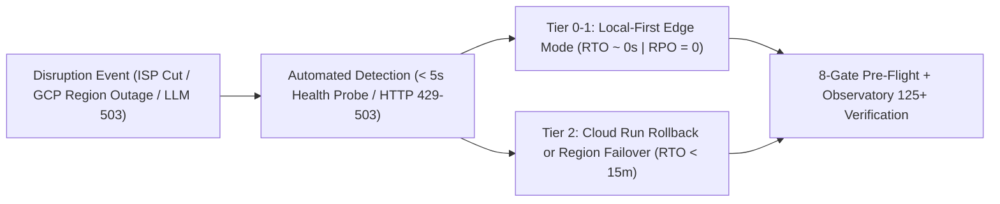

# 🛡️ PocketGull Business Continuity & IT Disaster Recovery Plan (BCP / IT DRP)

> **Document ID**: `PG-SOP-BCP-01` | **Version**: `1.42.0`  
> **Governing Frameworks**: FEMA / DHS Ready Business ([Ready.gov Recovery Plan](https://www.ready.gov/business/emergency-plans/recovery-plan)), HIPAA Security Rule Contingency Plan (`45 CFR § 164.308(a)(7)`), NIST SP 800-34 Rev. 1, ISO/IEC 22301:2019, FDA 21 CFR Part 11  
> **Entity**: PocketGull LLC (`pocketgull-app`)  
> **Target Cloud Infrastructure**: Google Cloud Platform Project `gen-lang-client-0540208645` (Organization `<REDACTED_ORG_ID>`)  
> **Continuity & Recovery Coordinator (DPO)**: `dpo@pocketgull.app`  
> **Companion Incident Playbook**: [INCIDENT_RESPONSE_BREACH_PLAYBOOKS.md](INCIDENT_RESPONSE_BREACH_PLAYBOOKS.md) (`PG-SOP-IR-01`)

---

## 1. Purpose, Scope & FEMA Ready.gov Four-Plan Alignment

This Standard Operating Procedure (SOP) establishes the operational **Business Continuity Plan (BCP)** and **IT Disaster Recovery Plan (IT DRP)** for PocketGull LLC. It maps the U.S. Department of Homeland Security / FEMA **Ready Business** continuity lifecycle (`ready.gov/business/emergency-plans/recovery-plan`) directly onto healthcare statutory mandates under **45 CFR § 164.308(a)(7)** (HIPAA Contingency Plan: Data Backup, Disaster Recovery, and Emergency Mode Operation).

Per FEMA Ready.gov guidelines, organizational resilience is partitioned into four interconnected emergency plans:

| Ready.gov Plan Pillar | Primary Objective | PocketGull Implementation & Governing Artifact |
| :--- | :--- | :--- |
| **1. Emergency Response Plan** | Life safety, initial 0–15 minute stabilization, clinical red-flag escalation, and public emergency routing. | Deterministic pre-LLM red-flag interception (`BE-FAST`, `ACS`, `SpO2 < 90%`, `C-SSRS`) in [`ClinicalTriageGuardService`](../../src/services/clinical-triage-guard.service.ts) and Five Eyes statutory emergency routing (`988` / `911` / `111` / `13 11 14` / `1737`) via [`JurisdictionGuardService`](../../src/services/jurisdiction-guard.service.ts). |
| **2. Business Continuity Plan (BCP)** | Maintaining or rapidly resuming time-sensitive clinical decision-support (CDS) functions during cloud, network, or facility disruptions. | **Zero-Remote PHI Persistence** + Local-First PWA execution (`IndexedDB` AES-GCM-256) + 100% deterministic edge failover via [`OfflineEdgeAiService`](../../src/services/offline-edge-ai.service.ts) (Gemma 4 Built-in AI, WebGPU, WASM ONNX). |
| **3. IT Disaster Recovery Plan (IT DRP)** | Restoring stateless cloud compute, container registries, cryptographic secrets, CDN typography, and audit logs within target RTO/RPO bounds. | Immutable SHA-256 Cloud Run deployments (`us-central1` + multi-region failover), Secret Manager versioned rotation, SLSA Level 3 container provenance, and BigQuery 6-year WORM audit retention. |
| **4. Crisis Communications Plan** | Internal command coordination and external notifications to clinicians, health system partners, CISA, and HHS OCR. | Governed by Section 6 below and Playbook 5 of [`INCIDENT_RESPONSE_BREACH_PLAYBOOKS.md`](INCIDENT_RESPONSE_BREACH_PLAYBOOKS.md) (72h CIRCIA, 60d HIPAA OCR, Five Eyes Commissioners). |

---

## 2. Business Impact Analysis (BIA) & Recovery Objectives

In accordance with the **Ready.gov Business Impact Analysis (BIA)** methodology and **NIST SP 800-34**, every PocketGull subsystem is classified by clinical safety criticality, operational/financial disruption impact, **Maximum Tolerable Downtime (MTD)**, **Recovery Time Objective (RTO)**, and **Recovery Point Objective (RPO)**.



### 2.1 Criticality Tier Matrix (RTO / RPO / MTD)

| Tier | Essential Function / Subsystem | Clinical & Operational Impact of Outage | RTO | RPO | MTD | Continuity Mechanism |
| :---: | :--- | :--- | :---: | :---: | :---: | :--- |
| **Tier 0** | **Life-Safety Red-Flag Interception & ISMP Posology Guard** | **Severe Clinical Risk**: Delayed recognition of stroke (`BE-FAST`), acute coronary syndrome, hypoxia (`SpO2 < 90%`), crisis (`C-SSRS`), or look-alike/sound-alike medication error. | **0 sec** *(Instant)* | **0** *(Zero loss)* | **0 sec** | 100% client-side synchronous TypeScript execution in [`ClinicalTriageGuardService`](../../src/services/clinical-triage-guard.service.ts) & [`IsmpSafetyGuardService`](../../src/services/ismp-safety-guard.service.ts). Zero network dependency. |
| **Tier 1** | **Active Patient State, Care Plan Strategy & FHIR R4 Export** | **High Operational Impact**: Clinician unable to view Three-Act trajectory or export signed HL7 FHIR R4 CarePlan bundle to partner EHR. | **< 5 sec** | **0** *(Local State)* | **15 min** | Client-side Angular Signals + encrypted local `IndexedDB` (`AES-GCM-256`) + offline SHA-256 sealed bundle serialization via [`FhirR4BundleExportService`](../../src/services/fhir-r4-bundle-export.service.ts). |
| **Tier 2** | **Stateless Cloud Run SSR & Genkit CDS API (`pocketgull-app`)** | **Moderate Operational Impact**: Loss of cloud Gemini 2.5 Pro/Flash synthesis; automatic fallback to local Gemma 4 / deterministic edge rules engages. | **< 15 min** | **0** *(Stateless)* | **4 hours** | Instant traffic shift to previous known-good Cloud Run revision or secondary GCP region (`us-east1`) from immutable Artifact Registry SHA-256 digest. |
| **Tier 3** | **Typography & Static Edge CDN (`font.pocketgull.app`)** | **Low Operational Impact**: Fallback to local cached WOFF2 service worker assets or clinical system monospace stack while preserving ISMP disambiguation. | **< 1 hour** | **0** *(Git-tracked)* | **24 hours** | Fastly Edge CDN multi-POP caching + Service Worker `CacheFirst` asset retention + automated redeploy (`npm run dart:fonts`). |
| **Tier 4** | **SIEM Forensic Ledger, BigQuery Analytics & Billing Checkout** | **Administrative / Financial Impact**: Delayed regulatory telemetry queries or commercial subscription upgrades (existing clinical access unaffected). | **< 4 hours** | **< 5 min** | **72 hours** | BigQuery multi-region dataset replication (`US` multi-region), GCS Bucket Lock (`6y` retention), and Stripe SAQ-A hosted failover. |

---

## 3. Incident Management Structure & Emergency Mode Activation

Per **45 CFR § 164.308(a)(7)(ii)(C)** (*Emergency Mode Operation Plan*) and Ready.gov Incident Management guidelines, PocketGull maintains a clear chain of command with Mandiant Dual-Custody separation of duties:

| Continuity Role | Primary Assignee / Identity | Responsibilities During Disruption |
| :--- | :--- | :--- |
| **Continuity & Incident Commander** | Lead DPO (`dpo@pocketgull.app`) | Declares Emergency Mode, authorizes regional failover, oversees statutory notifications, and signs post-recovery attestation. |
| **Clinical Safety Officer (Dual-Custody)** | Chief Clinical Officer / On-Call MD | Verifies deterministic clinical guardrails during degraded LLM outages; co-signs M-of-N approvals via [`MandiantClinicalDefenseService`](../../src/services/mandiant-clinical-defense.service.ts). |
| **Cloud Infrastructure & DR Lead** | Workload Identity Pipeline / Systems Architect | Executes Cloud Run revision rollbacks, multi-region redeployments, Secret Manager rotations, and `observatory:audit` verification. |

### Activation Triggers
Emergency Continuity Mode activates **automatically** at the client edge upon any of the following conditions, and **operationally** for the engineering team when sustained $> 5\text{ minutes}$:
1. Upstream AI endpoint (`aiplatform.googleapis.com` / `generativelanguage.googleapis.com`) returns `HTTP 503`, `HTTP 429`, or connection timeout $> 8,000\text{ ms}$.
2. Cloud Monitoring alerts on `cloud_run_revision` 5xx rate $> 5$ errors in $5\text{ minutes}$ (`notificationChannels/<REDACTED_CHANNEL_ID>`).
3. [`ClinicalDefenseGuardService`](../../src/services/clinical-defense-guard.service.ts) triggers `isContainmentModeActive.set(true)` due to adversarial prompt injection or telemetry taint anomaly.
4. Regional utility, fiber, or workstation outage affecting institutional thin-client clinics.

---

## 4. Continuity Strategies & Manual Clinical Workarounds

Ready.gov mandates explicit **Alternate Workspaces** and **Manual Workarounds** so essential workflows survive complete technology or cloud blackouts.

### 4.1 Automated Local-First Edge Continuity (Zero-Cloud Operation)
Because PocketGull enforces a **Zero-Remote PHI Persistence Architecture** ([`ENTERPRISE_SECURITY_DOSSIER.md`](ENTERPRISE_SECURITY_DOSSIER.md)), no centralized patient database exists to suffer ransomware encryption or regional database corruption:
* **On-Device AI Failover**: [`OfflineEdgeAiService`](../../src/services/offline-edge-ai.service.ts) seamlessly routes triage acuity classification and SOAP structuring through Chrome Built-in AI (`gemma-4-builtin-ai`), WebGPU SLMs (`gemma-2-2b-it-q4f16`), or deterministic clinical rules (`EDGE_DETERMINISTIC_RULES`) with explicit `[EXPLORATORY IN SILICO MODEL • NON-DIAGNOSTIC]` and fallback telemetry badges.
* **Persistent Storage & Local Backup Protection**: [`LocalSovereignVaultService`](../../src/services/storage/local-sovereign-vault.service.ts) and [`StorageService`](../../src/services/storage.service.ts) proactively invoke `navigator.storage.persist()` to prevent browser storage eviction under disk pressure, snapshot pre-upgrade records during `onupgradeneeded` schema migrations, queue idempotent outbox mutations, and support bidirectional **HL7 FHIR R4 JSON Bundle** export/rehydration (`exportSovereignPatientBundle()` / `importSovereignPatientBundle()`) with SHA-256 integrity seals (`45 CFR § 164.312(c)(1)`).
* **Safe Harbor Boundary**: Any asynchronous queue synced after connectivity restoration passes through [`DeIdentificationEngineService`](../../src/services/privacy/de-identification-engine.service.ts) to strip all 18 HIPAA §164.514 identifiers prior to cloud egress.

### 4.2 Clinical Paper & Manual Workarounds (Total Hardware / Power Loss)
If client workstation power or hardware is lost inside a clinical facility:
1. **Print-Ready Three-Act Care Summaries**: PocketGull's `@media print` stylesheet formats all active Three-Act Care Plans (*Act I: Days 0–30*, *Act II: Weeks 2–12*, *Act III: Months 6+*) into high-contrast, ink-efficient Caslon/Monospace physical handouts with slashed zeros (`cv08`) and explicit generic medication benchmarks.
2. **Immediate Escalation Bypass**: Clinicians revert immediately to institutional paper charting and direct statutory voice lines (**US/CA**: `911` / `988`; **UK**: `999` / `111`; **AU**: `000` / `13 11 14`; **NZ**: `111` / `1737`) without waiting for software restoration.
3. **Alternate Engineering Workspaces**: PocketGull source, infrastructure-as-code, and deterministic verification toolchains operate identically across isolated environments (Hardened Docker `--read-only --cap-drop=ALL` sandboxes, WSL2 persistent Linux runtimes, and GitHub Actions Keyless WIF runners), eliminating single-facility office dependency.

---

## 5. IT Disaster Recovery Procedures (Step-by-Step Runbooks)

### 5.1 Runbook A: Cloud Run Revision Corruption or Bad Release (`RTO < 5 min`)
Shift 100% of production traffic back to the prior SLSA-attested immutable revision:
```bash
# 1. Inspect recent revisions and SHA-256 image digests
gcloud run revisions list \
  --service=pocketgull-app \
  --project=gen-lang-client-0540208645 \
  --region=us-central1

# 2. Immediately route 100% traffic to the last verified revision
gcloud run services update-traffic pocketgull-app \
  --to-revisions=<KNOWN_GOOD_REVISION>=100 \
  --project=gen-lang-client-0540208645 \
  --region=us-central1
```

### 5.2 Runbook B: Primary GCP Region (`us-central1`) Outage (`RTO < 15 min`)
Because the Cloud Run backend is 100% stateless, redeploy the pinned SHA-256 container digest to the secondary failover region (`us-east1`) under the least-privilege workload identity:
```bash
# Deploy immutable container digest to secondary region with identical security posture
gcloud run deploy pocketgull-app \
  --image=us-docker.pkg.dev/gen-lang-client-0540208645/pocketgull-repo/pocketgull@sha256:<IMMUTABLE_DIGEST> \
  --service-account=pocketgull-run@gen-lang-client-0540208645.iam.gserviceaccount.com \
  --region=us-east1 \
  --min-instances=0 \
  --execution-environment=gen2 \
  --project=gen-lang-client-0540208645
```

### 5.3 Runbook C: Cryptographic Secret or API Key Recovery (`RTO < 10 min`)
Restore or rotate server-side credentials in Google Cloud Secret Manager without static JSON keys:
```bash
# Verify secret versions or roll back to prior enabled version if corrupted
gcloud secrets versions list GEMINI_API_KEY --project=gen-lang-client-0540208645

# Force zero-downtime revision refresh bound to latest valid secret version
gcloud run services update pocketgull-app \
  --project=gen-lang-client-0540208645 \
  --region=us-central1
```

### 5.4 Runbook D: Post-Recovery 8-Gate Re-Certification (Mandatory Exit Gate)
Before lifting Emergency Continuity Mode and declaring normal operations restored, the recovery build MUST pass all 8 deterministic pre-flight gates (`npm run deploy` / `GEMINI.md`):
1. **Strict Typecheck**: `tsc --noEmit`
2. **Hermetic Unit Suite**: `npx vitest run`
3. **Sentinel Egress & Motion Guard**: `npm run sentinel:audit` ([`sentinel_security_guard.mjs`](../../scripts/sentinel_security_guard.mjs))
4. **Supply Chain SBOM**: `npm run sbom` (CycloneDX 1.6)
5. **Mozilla HTTP Observatory 125+ Gate**: `npm run observatory:audit` ([`observatory_headers_guard.mjs`](../../scripts/observatory_headers_guard.mjs))
6. **IEEE P2933™ TIPPSS Wearable Parity**: `npm run tippss:audit`
7. **HIPAA Taint & Safe Harbor Scan**: `npm run taint:scan`
8. **FACTS Documentation & GCP IAM Audit**: `npm run docs:audit` & `npm run gcp:audit`

---

## 6. Crisis Communications, Critical Vendors & Emergency Contacts

In alignment with Ready.gov **Vendor & Stakeholder Contact Lists**, maintain out-of-band access to the following critical dependencies and regulatory authorities:

| Stakeholder / Vendor | Service / Role | Outage / Escalation Channel | SLA / Statutory Window |
| :--- | :--- | :--- | :--- |
| **PocketGull DPO & Continuity Lead** | Incident & DR Command | `dpo@pocketgull.app` / GCP Alert Channel `<REDACTED_CHANNEL_ID>` | `< 15 min` (P1) / `< 1 hr` (P2) |
| **Google Cloud Platform & Vertex AI** | Cloud Run, Secret Manager, Gemini BAA | [status.cloud.google.com](https://status.cloud.google.com) / GCP Enterprise Support | Enterprise BAA SLA |
| **Fastly / Firebase Edge Hosting** | `font.pocketgull.app` WOFF2 CDN | [status.fastly.com](https://status.fastly.com) / [status.firebase.google.com](https://status.firebase.google.com) | Multi-POP Auto-Failover |
| **GitHub Actions & GHCR** | Keyless WIF CI/CD & SLSA Attestations | [www.githubstatus.com](https://www.githubstatus.com) | Secondary Local CLI Deploy Ready |
| **Stripe Billing** | PCI-DSS SAQ-A Subscription Checkout | [status.stripe.com](https://status.stripe.com) | Decoupled from Clinical Access |
| **CISA (CIRCIA Reporting)** | Federal Cyber Incident Authority | [cisa.gov/report](https://www.cisa.gov/report) / `(888) 282-0870` | **72 hours** (Cyber) / **24h** (Ransom) |
| **U.S. HHS Office for Civil Rights** | HIPAA Security & Breach Authority | [ocrportal.hhs.gov](https://ocrportal.hhs.gov/ocr/breach/breach_report.jsf) | **60 calendar days** (if $\ge 500$) |

---

## 7. Training, Tabletop Exercising & Program Maintenance

Per **45 CFR § 164.308(a)(7)(ii)(D)** (*Testing and Revision Procedures*) and **Ready.gov Testing & Exercising** standards, a recovery plan is only valid when empirically tested:

1. **Automated Cyber & Continuity Tabletop Drills (`npm run tabletop:drill`)**:
   * Executed via [`simulate_clinical_cyber_tabletop.mjs`](../../scripts/simulate_clinical_cyber_tabletop.mjs) across 5 canonical crisis scenarios:
     * `SCN-01`: Upstream AI `HTTP 503` / `HTTP 429` Chaos Failover to `EDGE_DETERMINISTIC_RULES`.
     * `SCN-02`: Adversarial Indirect Prompt Injection & Zero-Width Unicode Stripping.
     * `SCN-03`: HIPAA §164.514 Safe Harbor Accidental PHI Egress Interception.
     * `SCN-04`: Mandiant Dual-Custody Multi-Signature Anti-Whaling Enforcement.
     * `SCN-05`: STAT Emergency Override & FDA 21 CFR Part 11 SHA-256 Forensic Receipt Sealing.
2. **Exercise & Review Cadence**:
   * **Every Release / Pre-Deploy**: Automated execution of `npm run tabletop:drill`, `npm run observatory:audit`, and `npm run docs:audit`.
   * **Quarterly**: Simulated Cloud Run revision traffic rollback and `OfflineEdgeAiService` airplane-mode clinical walkthrough across all 5 thin-client/mobile viewports.
   * **Annually (or upon Major Architectural Change)**: Full BIA RTO/RPO review, statutory FVEY contact audit, and DPO re-attestation (`dpo@pocketgull.app`).

---

<p align="center">
  <sub>© 2026 PocketGull LLC. Aligned with FEMA Ready Business, HIPAA §164.308(a)(7), NIST SP 800-34 Rev. 1, and SLSA Level 3 Standards.</sub>
</p>
